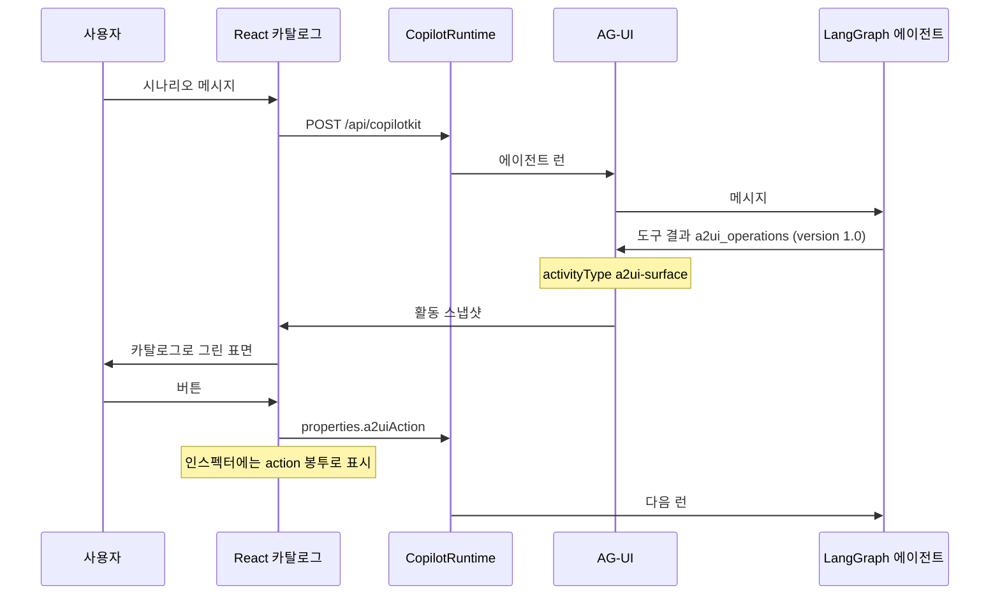
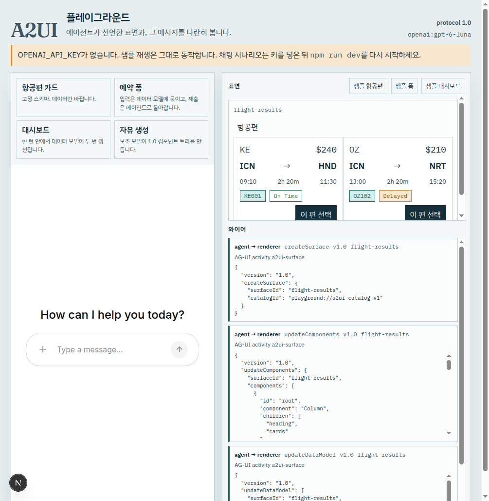
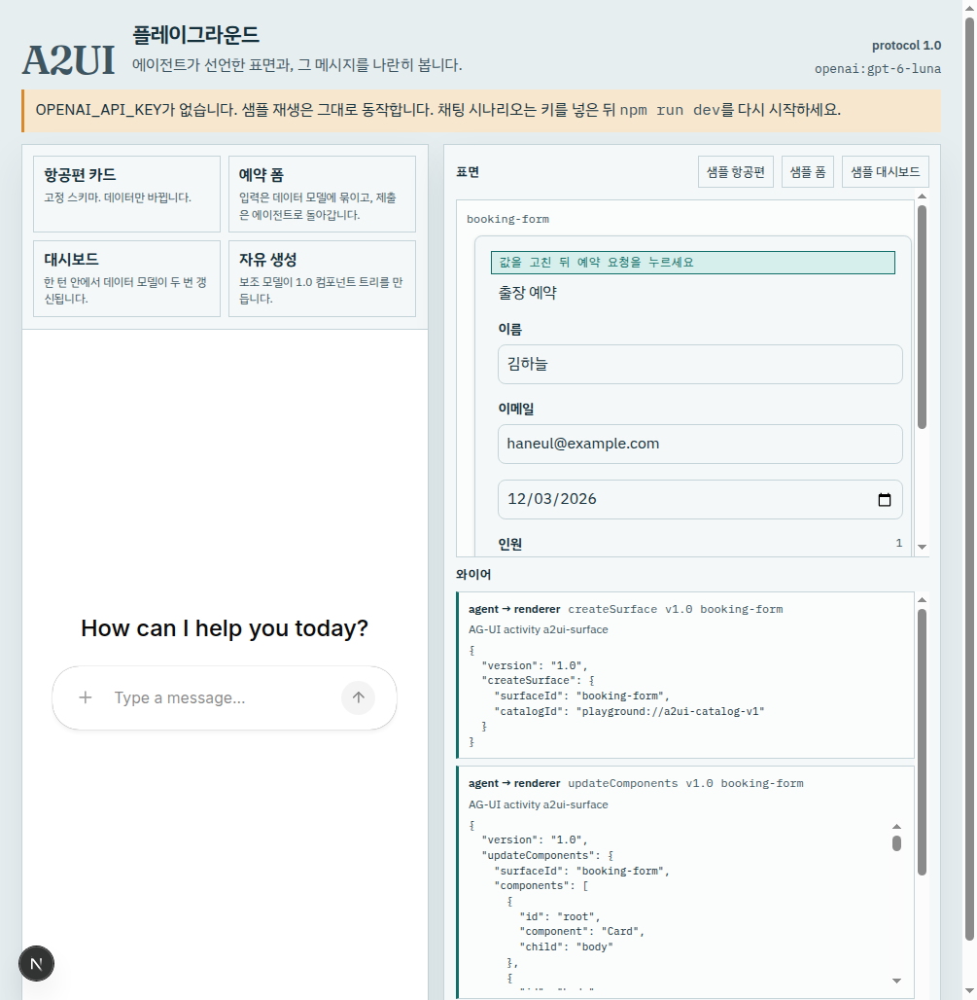
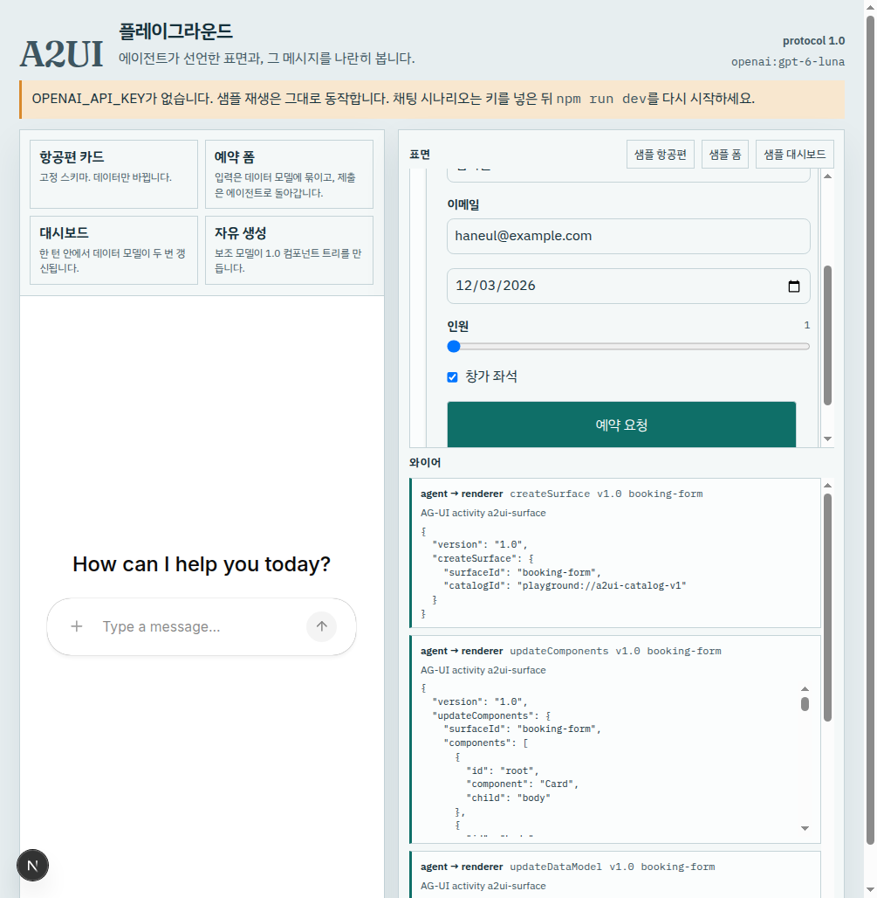
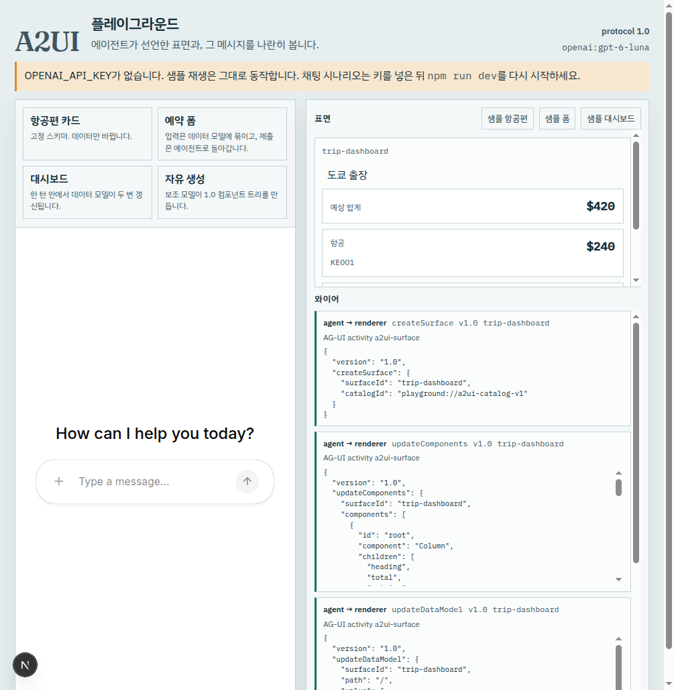

# A2UI 플레이그라운드

CopilotKit과 LangGraph(Python)로 [A2UI 1.0](https://a2ui.org/specification/v1.0-a2ui/) 표면을 채팅에서 띄우고, 그 와이어 메시지를 옆에서 읽는 공개 예제입니다.

유료로 필요한 것은 LLM API 키뿐입니다. 키가 없어도 오른쪽의 **샘플 재생**으로 같은 스키마를 렌더할 수 있습니다. CopilotKit Cloud, LangSmith, MCP 서버는 쓰지 않습니다.

이 저장소는 [CopilotKit의 LangGraph Python 스타터](https://github.com/CopilotKit/CopilotKit/tree/main/examples/integrations/langgraph-python) (`examples/integrations/langgraph-python`, MIT)를 바탕으로 만들었습니다. CLI 소스는 넣지 않았고, 아카이브된 `with-a2a-a2ui` 예제도 쓰지 않았습니다. 출처는 [NOTICE](NOTICE)와 [LICENSE](LICENSE)에 있습니다.

## A2UI가 무엇인가

A2UI(Agent-to-UI)는 에이전트가 UI를 문장으로 설명하는 대신, 컴포넌트 트리와 데이터 모델을 JSON으로 보내는 명세입니다. 렌더러는 미리 등록된 카탈로그 안에서만 그 트리를 그립니다. 에이전트는 임의의 HTML을 보내지 않습니다.

1.0은 2026-11-11에 안정화된 현재 명세입니다. 데이터 바인딩은 `{"@path": "/form/name"}`, 함수 호출은 `{"@call": "formatString", "args": {...}}` 입니다. 리스트를 반복하는 자식 템플릿만 `{"componentId": "metric", "path": "/metrics"}`처럼 `path`를 그대로 둡니다. `updateDataModel`의 `path`도 메시지 필드라서 접두사가 없습니다. v0.9의 `{path}`와 1.0의 `{@path}`를 한 트리에 섞지 않습니다.

커스텀 컴포넌트에서 바인딩되는 prop은 `DynamicStringSchemaV1` 같은 1.0 스키마여야 합니다. `z.string()`으로 선언하면 바인더가 객체를 풀지 않고, React가 그 객체를 그리려다 에러 #31을 냅니다.

## AG-UI가 CopilotKit에서 A2UI를 나르는 방식

채팅 런타임은 A2UI 소켓을 따로 열지 않습니다. 에이전트 도구가 `a2ui_operations` JSON을 반환하면 CopilotKit 미들웨어가 그것을 AG-UI 활동 `a2ui-surface`로 바꿉니다. 브라우저의 카탈로그가 그 활동을 표면으로 그립니다. 버튼은 `properties.a2uiAction`으로 다음 런에 실리고, 인스펙터는 그 값을 명세의 `renderer_to_agent` `action` 봉투로 보여 줍니다.



고정 스키마 도구는 컴포넌트 트리를 JSON으로 들고 있고, 모델은 데이터만 채웁니다. 자유 생성(`generate_a2ui`)만 보조 모델이 트리를 만듭니다. 런타임의 `injectA2UITool`은 꺼 두었습니다. 주입되는 도구는 v0.9 생성 경로라서, 1.0 도구는 파이썬 그래프가 직접 갖습니다.

## 해볼 수 있는 것

채팅 시나리오 네 가지와, 키 없이 같은 표면을 재생하는 샘플 세 가지가 있습니다.

| 시나리오 | 하는 일 |
| --- | --- |
| 항공편 카드 | 고정 스키마 `FlightCard`. `search_flights`가 데이터만 넣습니다. **이 편 선택**은 `book_flight`로 돌아갑니다. |
| 예약 폼 | `TextField`, `DateTimeInput`, `Slider`, `CheckBox` 값이 `/form/...`에 묶입니다. **예약 요청**은 그 시점의 값을 `submit_booking` 컨텍스트로 보냅니다. |
| 대시보드 | `PriceTag`, `MetricTile`, `StatusPill`. 한 번의 도구 결과가 `updateDataModel`을 두 번 보내 목록과 알림을 이어서 바꿉니다. 다음 턴의 `patch_dashboard`는 같은 `surfaceId`로 `createSurface`를 다시 보냅니다. |
| 자유 생성 | 보조 모델이 1.0 트리를 만듭니다. v0.9 `{path}`가 섞이면 컴포넌트 트리만 1.0으로 고칩니다. |

커스텀 컴포넌트는 `FlightCard`, `PriceTag`, `StatusPill`, `MetricTile`입니다. `Text`, `Column`, `Row`, `Card`, `List`, `Button`, `TextField` 등은 1.0 기본 카탈로그입니다.

오른쪽 **와이어** 패널은 `agent_to_renderer`(`createSurface`, `updateComponents`, `updateDataModel`)와 `renderer_to_agent`(`action`)를 순서대로 보여 줍니다. 활동에서 온 것인지, `a2uiAction`을 명세 봉투로 정규화한 것인지 각 줄에 적혀 있습니다.

채팅 안의 카드와 오른쪽 표면은 따로 그립니다. CopilotKit은 활동마다 렌더러를 새로 만들기 때문에, 나중 턴의 `updateDataModel`만으로는 새 카드가 빈 표면이 됩니다. 그래서 갱신 도구는 `createSurface`를 다시 포함하고, 오른쪽 스테이지는 같은 `surfaceId`의 마지막 스냅샷으로 접습니다.

## 실행

Node.js 22, Python 3.12, [uv](https://docs.astral.sh/uv/)가 필요합니다.

```bash
cp .env.example .env
# .env에 OPENAI_API_KEY를 넣습니다. 샘플만 볼 거면 비워 두어도 됩니다.
npm install
npm run dev
```

`npm install`은 에이전트 가상환경까지 만듭니다. `npm run dev`는 Next.js(3000)와 LangGraph(8123, `AGENT_URL`)를 같이 띄웁니다. 브라우저에서 [http://localhost:3000](http://localhost:3000)을 엽니다.

모델은 `COPILOTKIT_AGENT_MODEL`입니다. 기본값은 `openai:gpt-6-luna`이고, 2026-11-27 OpenAI 모델 문서 기준으로 유효한 id입니다. Chat Completions에서 함수 호출을 쓰므로 Luna에는 `reasoning_effort=none`을 붙입니다. OpenAI 호환 서버는 `OPENAI_BASE_URL`과 `openai:<모델 id>` 조합으로 가리킵니다. Anthropic과 Google 파서는 들어 있지만, 이 이미지에 설치된 모델 패키지는 `langchain-openai`뿐입니다.

`CPK_INTELLIGENCE_API_KEY`가 없으면 런너는 `InMemoryAgentRunner`입니다. 그 모드의 스레드 목록은 로컬 한 명용으로 `threads.access: "open"`입니다. 여러 사람이 이 서버에 닿으면 그 설정은 쓰지 마세요.

## 버전을 고정한 이유

| 핀 | 이유 |
| --- | --- |
| `next@16.3.8`, `react@^19.2.4` | 스타터와 같은 앱 스택 |
| `@copilotkit/react-core`, `runtime`, `a2ui-renderer` `1.90.2` | 2026-11-23 모노레포 정렬 릴리스. 렌더러 기본 프로토콜은 v0.9라서 카탈로그에서 1.0을 명시합니다. |
| `@a2ui/web_core@0.15.0` | CopilotKit이 고정한 버전. npm의 0.16.1로 올리지 않습니다. `overrides`로도 0.15.0을 유지합니다. |
| `zod@^3.25.76` | Zod 4는 CopilotKit에서 깨집니다 ([#7967](https://github.com/CopilotKit/CopilotKit/issues/7967)). |
| `@ag-ui/client`, `core`, `encoder`, `proto` `1.0.5` | 스타터와 같은 override |
| `@ag-ui/langgraph@0.0.46` (JS) | `@copilotkit/runtime@1.90.2`가 의존하는 버전. 스타터 lock과 같습니다. 따로 내리거나 올리지 않습니다. |
| `langgraph==1.2.11`, `copilotkit==0.1.96` | 스타터와 같은 에이전트 스택 |
| `ag-ui-langgraph[fastapi]==0.0.44` (Python) | 0.0.43은 요청마다 `clone()`이 받지 않는 인자를 넘겨 500을 냅니다. 0.0.45의 A2UI 히스토리 복구는 `__overwrite__`로 dict 메시지를 넣고, LangGraph 1.2.11은 그걸 `add_messages` 없이 저장합니다. 0.0.44에 둡니다. |
| `ag-ui-protocol==0.1.22` | 0.0.44가 요구하는 범위 |

파이썬 `copilotkit.a2ui.create_surface`는 아직 `"version": "v0.9"`를 만듭니다. 이 저장소의 `agent/src/a2ui_v1.py`가 1.0 봉투를 만들고, 감싸기는 `a2ui.render`에 맡겨 `a2ui_operations` 키를 맞춥니다.

## CopilotKit의 1.0 지원 한계

카탈로그는 `createCatalog(..., { catalogId, protocolVersion: "1.0", includeBasicCatalog: true })`로 1.0 기본 카탈로그를 합칩니다. 표면의 `version`이 `"1.0"`이면 `@path` / `@call`을 풀고, 기본 카탈로그 컴포넌트를 그립니다.

아직 기대하면 안 되는 것:

- `callRendererFunction` / `callAgentFunction`과 그 응답. 이 플레이그라운드는 그 RPC를 보내지 않습니다. 사용자 동작은 `action.event`와 `a2uiAction`입니다.
- 주입된 `generate_a2ui`. 꺼 두었고, 그래프의 도구가 1.0 트리를 만듭니다.
- 활동이 달라도 한 표면 인스턴스가 이어진다는 가정. 활동마다 렌더러가 새로 생깁니다.
- `@a2ui/web_core@0.15.0`의 `DynamicStringSchemaV1`은 전환기 호환으로 `{path}`도 파싱합니다. 우리가 작성한 스키마는 `@path`만 씁니다.
- 컴포넌트 id는 UAX #31입니다. `flight-card`처럼 하이픈이 있으면 렌더러가 표면을 거절합니다. id는 `flightCard`처럼 둡니다.

업스트림에서 아직 열린 이슈입니다. 여기서 우회 코드를 넣지 않았습니다.

- [#8261](https://github.com/CopilotKit/CopilotKit/issues/8261) 프로덕션에서 `text` 컴포넌트를 모른다고 하는 경우. 이 스키마는 `Text`를 씁니다.
- [#8272](https://github.com/CopilotKit/CopilotKit/issues/8272) 거절된 연산이 렌더된 것처럼 보고되는 경우.
- [#8125](https://github.com/CopilotKit/CopilotKit/issues/8125) 카탈로그 스키마가 두 번 전달되는 경우.

## 스크린샷

샘플 재생입니다. 이 환경에는 LLM 키가 없어 실제 모델 호출은 하지 않았습니다. 바인딩과 버튼 컨텍스트는 브라우저에서 확인했습니다. `이 편 선택`은 `book_flight` 컨텍스트에 `KE001` / `ICN` / `HND` / `$240`을 넣었고, `예약 요청`은 이름, 이메일, `2026-12-03`, 인원 1, 창가 좌석 `true`를 `submit_booking`으로 돌려보냈습니다.









## 테스트

```bash
npm test          # vitest. 카탈로그, 커스텀 컴포넌트, 와이어 분류, 스키마 린트
npm run test:agent  # pytest. 1.0 연산, 바인딩 업그레이드, 도구 렌더. 모델 호출 없음
npm run lint
npm run typecheck
npm run build
```

GitHub Actions (`.github/workflows/ci.yml`)가 같은 순서를 돌립니다. CI에는 LLM 키가 없습니다.

확인한 것: 위 테스트, `next build`, `npm run dev`로 UI와 에이전트(`http://localhost:8123/ok`)가 뜨는 것, 샘플 세 표면의 렌더와 액션 봉투. 확인하지 못한 것: 실제 모델이 도구를 고르고 문장을 돌려주는 왕복.
